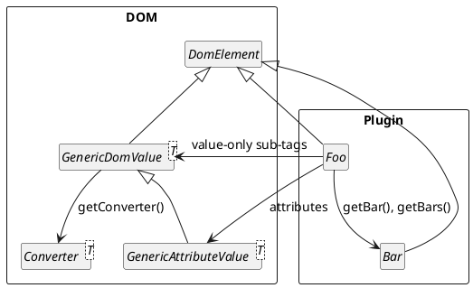

<!-- Copyright 2000-2026 JetBrains s.r.o. and contributors. Use of this source code is governed by the Apache 2.0 license. -->

# Defining a DOM Model

<link-summary>Registering DOM files and representing tag content, attributes, and sub-tags in DOM interfaces.</link-summary>

A DOM model consists of interfaces extending [`DomElement`](%gh-ic%/xml/dom-openapi/src/com/intellij/util/xml/DomElement.java), one for each kind of XML tag, and a file description that binds the root interface to XML files.
This page describes how to register the file description and how to declare tag content, attributes, and sub-tags in the interfaces.
For an overview of how the model relates to DOM and XML PSI classes, see the [key classes](xml_models_dom.md#key-classes) diagram.

## File Description

To register DOM files, extend [`DomFileDescription`](%gh-ic%/xml/dom-openapi/src/com/intellij/util/xml/DomFileDescription.java),
passing the root element interface and the root tag name to its constructor.
Register it in <path>[plugin.xml](plugin_configuration_file.md)</path>
using <include from="snippets.topic" element-id="ep"><var name="ep" value="com.intellij.dom.fileMetaData"/></include>
with the following attributes:

* `implementation` - the `DomFileDescription` inheritor.
* `rootTagName` - the unqualified root tag name.
  Omit it if the set of root tag names is not known in advance;
  then the IDE calls `DomFileDescription.isMyFile()` to determine whether the description applies to a file.
* `domVersion` - increase it whenever the logic determining which files the description applies to changes.
* `stubVersion` - specify it if the model uses [stubs](#dom-stubs), and increase it whenever the stub structure changes.

To restrict the description to some of the files with the given root tag name, for example, by namespace, override `isMyFile(XmlFile)`.

Override the following `DomFileDescription` methods to configure the model:

* `initializeFileDescription()` - register [namespace policies](#namespace-support) and [type choosers](#type-choosers).
* `createAnnotator()` - provide [highlighting annotations](dom_highlighting_and_resolving.md#highlighting-annotations).
* `getIdentityScope()` - define the scope in which [element names must be unique](dom_highlighting_and_resolving.md#automatic-highlighting).
* `getResolveScope()` - define the scope in which [references are resolved](dom_highlighting_and_resolving.md#resolving).
* `getFileIcon()` - provide an icon for the files.

## DOM Element Types

Getters in DOM interfaces return DOM elements representing tags and attributes.
The following diagram shows the element types and how they relate:



* A tag with attributes or sub-tags is represented by a plugin interface extending `DomElement`, like `Foo` and `Bar`.
  Its getters return the DOM elements of its sub-tags, either as a single element or as a list.
* A tag containing only a value is represented by [`GenericDomValue<T>`](%gh-ic%/xml/dom-openapi/src/com/intellij/util/xml/GenericDomValue.java), so the plugin doesn't need to define an interface for it.
* An attribute is represented by [`GenericAttributeValue<T>`](%gh-ic%/xml/dom-openapi/src/com/intellij/util/xml/GenericAttributeValue.java), which extends `GenericDomValue<T>` with access to the underlying XML attribute.
* Both convert values between XML text and `T` using a [`Converter<T>`](%gh-ic%/xml/dom-openapi/src/com/intellij/util/xml/Converter.java).

## Tag Content

XML PSI refers to tag content as _tag value_, and this page uses the same term.
To read and change a tag value, add a getter and a setter to the interface:

```java
String getValue();
void setValue(String s);
```

`getValue()` and `setValue()` are the default names of tag value accessors.
To use custom method names, annotate the methods with [`@TagValue`](%gh-ic%/xml/dom-openapi/src/com/intellij/util/xml/TagValue.java):

```java
@TagValue
String getTagValue();

@TagValue
void setTagValue(String s);
```

These accessors work with `String` values, as XML tag content is always text.
A model can also operate with integers, booleans, enums, class names (represented as [`PsiClass`](%gh-ic%/java/java-psi-api/src/com/intellij/psi/PsiClass.java)), or Java types ([`PsiType`](%gh-ic%/java/java-psi-api/src/com/intellij/psi/PsiType.java)).
In such cases, change the accessor types to the required ones.

### Custom Value Types

For other types, annotate the accessor methods with [`@Convert`](%gh-ic%/xml/dom-openapi/src/com/intellij/util/xml/Convert.java) and specify a class extending `Converter<T>`, where `T` is the custom type.
A converter converts values between `String` and `T`.
If a value can't be converted (for example, "foo" to `Integer`), the converter can return `null`.
The converter class must have a no-argument constructor.

For enum types, the default converter searches for enum constants with the names specified in XML.
Sometimes, XML values are not valid Java identifiers.
For example, the CMP version in EJB can be "1.x" or "2.x", which can't be used as enum constant names.
In such cases, let the enum implement [`NamedEnum`](%gh-ic%/xml/dom-openapi/src/com/intellij/util/xml/NamedEnum.java) and return the value matching the XML content from `getValue()`:

```java
enum CmpVersion implements NamedEnum {
  CmpVersion_1_X ("1.x"),
  CmpVersion_2_X ("2.x");

  private final String value;

  CmpVersion(String value) {
    this.value = value;
  }

  public String getValue() {
    return value;
  }
}
```

### Value-Only Tags

Besides a value, an XML tag can have attributes and sub-tags.
However, many tags (according to DTD or Schema) contain only a value.
DOM represents such tags with `GenericDomValue<T>`,
which provides the following methods:

* `getValue()` and `setValue()` - get and set the tag value converted to `T`.
* `getStringValue()` and `setStringValue()` - get and set the tag value as a `String`, without conversion to `T`.
* `getRawText()` - returns the tag value text exactly as specified in XML, without any conversions or substitutions.
* `getConverter()` - returns the `Converter` used to convert values between `String` and `T`.

Specify a particular `T` when using this interface.
The `String` accessors are useful, for example, when `T` is `PsiClass`,
and the UI needs to highlight invalid values:
`getStringValue()` returns the string from the XML file even if it can't be resolved to a class, and the converter provides the error message via `getErrorMessage()`.

## Attributes

Attribute values can be read and set, and they can have different types.
DOM represents attributes with `GenericAttributeValue<T>`, which extends `GenericDomValue<T>`
and additionally provides access to the underlying XML PSI:

* `getXmlAttribute()` - returns the underlying [`XmlAttribute`](%gh-ic%/xml/xml-psi-api/src/com/intellij/psi/xml/XmlAttribute.java).
* `getXmlAttributeValue()` - returns the underlying [`XmlAttributeValue`](%gh-ic%/xml/xml-psi-api/src/com/intellij/psi/xml/XmlAttributeValue.java).

For example, an attribute named `some-class` with a value of type `PsiClass` is declared with the [`@Attribute`](%gh-ic%/xml/dom-openapi/src/com/intellij/util/xml/Attribute.java) annotation as follows:

```java
@Attribute("some-class")
GenericAttributeValue<PsiClass> getMyAttributeValue();
```

The returned value supports getting and setting the value, resolving the `PsiClass`, getting its `String` representation, etc.
If the method name matches the attribute name according to the [name strategy](#name-strategy), the annotation can be omitted:

```java
GenericAttributeValue<PsiClass> getSomeClass();
```

If the attribute type is not `PsiClass`, but a custom `T` requiring a converter, annotate the getter with `@Convert`.

The attribute getter never returns `null`, even if the attribute isn't specified in XML.
In this case, its `getValue()`, `getStringValue()`, and `getXmlAttribute()` methods return `null`, but the DOM element exists and is valid.
To remove an existing underlying attribute, call `DomElement.undefine()`:
the XML attribute is deleted, while the `GenericAttributeValue` remains valid.

### Name Strategy

[`DomNameStrategy`](%gh-ic%/xml/dom-openapi/src/com/intellij/util/xml/DomNameStrategy.java) specifies how to convert accessor names without the `get`, `set`, or `is` prefixes to XML element names.
Specify the strategy class in the [`@NameStrategy`](%gh-ic%/xml/dom-openapi/src/com/intellij/util/xml/NameStrategy.java) annotation on a DOM element interface.
All descendants and children of this interface use this strategy.
The default strategy is [`HyphenNameStrategy`](%gh-ic%/xml/dom-openapi/src/com/intellij/util/xml/HyphenNameStrategy.java), which delimits words with hyphens, as in the sample above.
Another common strategy is [`JavaNameStrategy`](%gh-ic%/xml/dom-openapi/src/com/intellij/util/xml/JavaNameStrategy.java), which follows the Java naming convention.
With it, the attribute name in the example would be `someClass`.

## Children: Fixed Number
{#children-fixed-number}

Tags often have at most one sub-tag with a given name,
for example, `<ejb-name>`, `<ejb-class>`, or `<cmp-field>` in tags defining entity EJBs.
To access such children, declare getters with a return type extending `DomElement`:

```java
GenericDomValue<String> getEjbName();
GenericDomValue<String> getEjbClass();
CmpField getCmpField();
```

To designate such children explicitly, use the [`@SubTag`](%gh-ic%/xml/dom-openapi/src/com/intellij/util/xml/SubTag.java) annotation.
Its `value` attribute specifies the tag name.
If it is not specified, the name is derived from the method name using the current name strategy.

For some sub-tags, their presence matters rather than their content, for example, `<unchecked>` in EJB method permissions:
if the sub-tag exists, permissions are unchecked; otherwise, they are checked.
Represent such sub-tags with a `GenericDomValue<Boolean>` child.
By default, its `getValue()` returns `true` if the tag value is "true", `false` if it is "false", and `null` otherwise.
To change this, specify `indicator = true` in the `@SubTag` annotation.
Then `getValue()` returns `true` if the tag exists, and `false` otherwise.

Some tags contain a fixed number (greater than one) of sub-tags with the same name.
For example, an EJB relation has two roles, each represented by an `<ejb-relationship-role>` tag.
Representing them as a collection would require checking the number of elements on every access.
Instead, DOM supports declaring a separate getter for each sub-tag, with its index:

```java
@SubTag(value = "ejb-relationship-role", index = 0)
EjbRelationshipRole getEjbRelationshipRole1();

@SubTag(value = "ejb-relationship-role", index = 1)
EjbRelationshipRole getEjbRelationshipRole2();
```

The first method returns the DOM element for the first `<ejb-relationship-role>` sub-tag, and the second method returns the element for the second one.
Such children are called _fixed-number_ children, as DTD or Schema defines a fixed number of sub-tags with the given name.
Most often, this number is 1; for EJB relations, it is 2.
Like attributes, fixed-number children exist regardless of whether the underlying tag exists.
To delete their tags, call `undefine()`.

Converters can be specified for `GenericDomValue` children in the same way as for attributes.

## Children: Collections
{#children-collections}

DTDs and Schemas often define children with the same tag name and no fixed upper limit of their number.
Accessors for such children return a `Collection` or `List` of a type extending `DomElement`.
To derive the tag name using the name strategy, use the plural form in the method name, for example:

```java
List<Entity> getEntities();
```

To specify the tag name explicitly, use the [`@SubTagList`](%gh-ic%/xml/dom-openapi/src/com/intellij/util/xml/SubTagList.java) annotation.

Returned collections can't be modified directly.
To delete an element from a collection, call `undefine()` on it.
This removes the tag and makes the element invalid (`DomElement.isValid()` returns `false`).
This behavior differs from fixed-number children and attributes, which remain valid after `undefine()`.
Also, unlike them, collection children always have valid underlying XML tags.

DOM creates all elements internally, so it is not possible to add an existing DOM element to a collection.
Instead, declare methods in the parent element that add a child to the collection:

```java
// adds an element at the given index
Entity addEntity(int index);

// adds an element to the end of the collection
Entity addEntity();
```

Note the singular form of "Entity" in the method names, as these methods add a single element.
The returned element can then be modified: define its value, children, etc.

### Mixed Collections

Another common case is a collection of tags with different names mixed in arbitrary order.
To work with it, define collection getters for all tag names in the mixed collection and an additional getter annotated with [`@SubTagsList`](%gh-ic%/xml/dom-openapi/src/com/intellij/util/xml/SubTagsList.java):

```java
// <foo> elements
List<Foo> getFoos();

// <bar> elements
List<Bar> getBars();

// all <foo> and <bar> elements
@SubTagsList({ "foo", "bar" })
List<FooBar> getMergedListOfFoosAndBars();
```

The annotation is mandatory, as DOM can't derive several tag names from one method name.

To add elements to a mixed collection, declare an "add" method for each possible tag name:

```java
@SubTagsList(value = { "foo", "bar" }, tagName = "foo")
FooBar addFoo();

@SubTagsList(value = { "foo", "bar" }, tagName = "bar")
FooBar addBar(int index);
```

The `index` parameter in the last example is the index in the merged collection, not in the collection of `<bar>` tags.

## Mapping Summary

The following table summarizes how XML constructs are declared in DOM interfaces and how the resulting DOM elements behave.

| XML construct | Declaration example | Annotation, if the name can't be derived | Element exists without XML | After `undefine()` |
|---|---|---|---|---|
| [Tag value](#tag-content) | `String getValue()` | `@TagValue` | - | - |
| [Attribute](#attributes) | `GenericAttributeValue<T> getFoo()` | `@Attribute` | Yes | Stays valid |
| [Value-only sub-tag](#value-only-tags) | `GenericDomValue<T> getFoo()` | `@SubTag` | Yes | Stays valid |
| [Single sub-tag](#children-fixed-number) | `Foo getFoo()` | `@SubTag` | Yes | Stays valid |
| [N-th same-named sub-tag](#children-fixed-number) | `Foo getFoo1()` | `@SubTag(value = "foo", index = 0)` | Yes | Stays valid |
| [Repeated sub-tags](#children-collections) | `List<Foo> getFoos()` | `@SubTagList` | No | Becomes invalid |
| [Mixed sub-tags](#mixed-collections) | `List<FooBar> getFooBars()` | `@SubTagsList` (always required) | No | Becomes invalid |

## Required Children

A common error case is a missing required sub-tag or attribute.
To mark a child as required, annotate its getter with [`@Required`](%gh-ic%/xml/dom-openapi/src/com/intellij/util/xml/Required.java).
For collection getters, this annotation means that the collection must not be empty (corresponding to `+` in DTD).
Creating a new element with required fixed-number or attribute children also creates their tags or attributes in XML.
Missing required children are [highlighted automatically](dom_highlighting_and_resolving.md#automatic-highlighting).

## Type Choosers

A collection can contain same-named tags that have different structures or even different types in the DTD or Schema.
For example, JSF managed beans can be of three types, all extending `ManagedBean`:

* `MapEntriesBean`, if the `<managed-bean>` tag contains a `<map-entries>` sub-tag
* `ListEntriesBean`, if it contains a `<list-entries>` sub-tag
* `PropertyBean` otherwise

Each element of the list returned by `List<ManagedBean> getManagedBeans()` should implement the specific interface:
`MapEntriesBean`, `ListEntriesBean`, or `PropertyBean`.

To choose the interface that a DOM element implements depending on its tag, extend [`TypeChooser`](%gh-ic%/xml/dom-openapi/src/com/intellij/util/xml/TypeChooser.java) and implement its methods:

* `chooseType()` chooses the type (most often a class) for the given tag.
* `distinguishTag()` does the reverse: it modifies the tag so that the DOM element created from it later
  (for example, after the user reopens the project) implements the same interface, and no model data is lost.
* `getChooserTypes()` returns all types that `chooseType()` can return.

To register the `TypeChooser`, call `registerTypeChooser()` in the overridden `DomFileDescription.initializeFileDescription()` method.

## Namespace Support

Annotate the DOM model with [`@Namespace`](%gh-ic%/xml/dom-openapi/src/com/intellij/util/xml/Namespace.java)
and register the namespace key mapping via `DomFileDescription.registerNamespacePolicy()` in `DomFileDescription.initializeFileDescription()`.

## Dynamic Definition

To extend existing DOM models at runtime, implement [`DomExtender<T>`](%gh-ic%/xml/dom-openapi/src/com/intellij/util/xml/reflect/DomExtender.java).
Register it in the `extenderClass` attribute of <include from="snippets.topic" element-id="ep"><var name="ep" value="com.intellij.dom.extender"/></include>, where `domClass` specifies the extended DOM class `T`.
[`DomExtensionsRegistrar`](%gh-ic%/xml/dom-openapi/src/com/intellij/util/xml/reflect/DomExtensionsRegistrar.java) provides methods to register dynamic attributes and children.

If the contributed elements depend on anything other than plain XML file content (framework version, libraries in the classpath, etc.), return `false` from `DomExtender.supportsStubs()`.

## Implementation

A model sometimes needs functionality that isn't directly connected to XML, but relates to the program logic.
The DOM element interface is the most appropriate place for such functionality.

In the simplest case, a method returns the same value as another getter in this element or in one of its children.
Declare such a method and annotate it with [`@PropertyAccessor`](%gh-ic%/xml/dom-openapi/src/com/intellij/util/xml/PropertyAccessor.java), specifying the path of property names (getter names without the `get` or `is` prefixes):

```java
GenericDomValue<String> getVeryLongName();

@PropertyAccessor("very-long-name")
GenericDomValue<String> getName();
```

In this case, the second method returns the same value as the first one.
With the "foo.bar.name" path in the annotation, DOM would call `getFoo().getBar().getName()` and return the result.
Such annotations are useful when extending an interface that is inconsistent with the model,
or when extracting a common super-interface from two model interfaces with differently named children that have the same meaning (for example, `<ejb-ref>` and `<ejb-local-ref>`).

More often, the model requires custom logic implemented in code.
Add the required methods to the interface, then create an abstract class implementing the interface,
and implement only the added methods that are not directly connected to the XML model.
The class must have a no-argument constructor.

Register the class using <include from="snippets.topic" element-id="ep"><var name="ep" value="com.intellij.dom.implementation"/></include>.
DOM then generates at runtime a class that implements the interface and extends the abstract class.

## DOM Stubs

> Use stubs sparingly and only for heavily accessed parts of the DOM model, as they increase disk space usage and indexing time.
>
{style="note"}

DOM elements can be stubbed, so that costly access to XML PSI is not necessary
(see [](indexing_and_psi_stubs.md) for a similar feature for custom languages).
To stub performance-relevant elements, annotate their tag or attribute getters with [`@Stubbed`](%gh-ic%/xml/dom-openapi/src/com/intellij/util/xml/Stubbed.java).
Set the `stubVersion` attribute of the [file description](#file-description) registration,
and increase it whenever the usage of `@Stubbed` annotations changes in the DOM hierarchy to trigger rebuilding stubs during indexing.

## IDE Support

_Plugin DevKit_ supports the following features for working with DOM-related code:

* `DomElement` - provide implicit usages for all DOM-related methods defined in inheriting classes (to suppress the "unused method" warning)
* [`DomElementVisitor`](%gh-ic%/xml/dom-openapi/src/com/intellij/util/xml/DomElementVisitor.java) - provide implicit usages for all DOM-related visitor methods defined in inheriting classes (to suppress the "unused method" warning)
