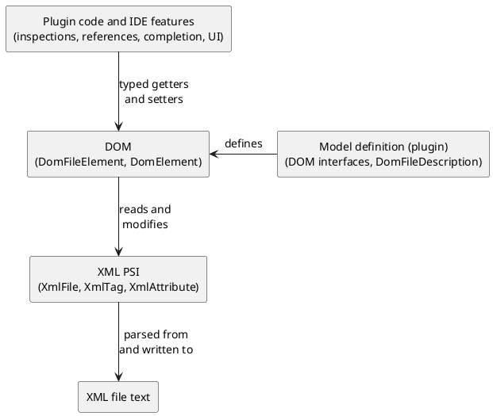
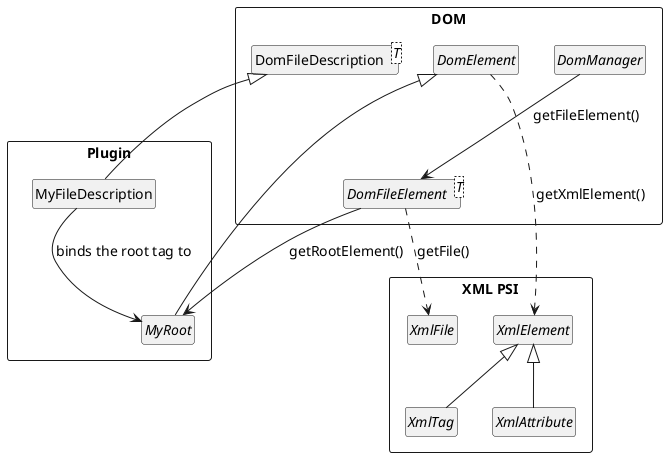

<!-- Copyright 2000-2026 JetBrains s.r.o. and contributors. Use of this source code is governed by the Apache 2.0 license. -->

# XML Models (DOM)

<link-summary>Implementing APIs for accessing XML models.</link-summary>

The _Document Object Model_ (DOM) in the IntelliJ Platform is an API for working with DTD- or Schema-based XML models.
It is intended for plugins that provide framework or server integrations, or a UI for editing XML files.

The reader is expected to be familiar with Java, the IntelliJ Platform XML PSI
(classes [`XmlTag`](%gh-ic%/xml/xml-psi-api/src/com/intellij/psi/xml/XmlTag.java), [`XmlFile`](%gh-ic%/xml/xml-psi-api/src/com/intellij/psi/xml/XmlFile.java), [`XmlTagValue`](%gh-ic%/xml/xml-psi-api/src/com/intellij/psi/xml/XmlTagValue.java), etc.),
and IntelliJ Platform plugin development basics ([services](plugin_services.md), [extension points](plugin_extensions.md)).

## XML PSI vs DOM

Working with XML through PSI usually means taking an `XmlFile`, getting its root tag, and then finding the required sub-tag by a path of tag names.
Typing these string names everywhere is tedious and error-prone.
Consider the following XML:

```xml
<root>
  <foo>
    <bar>42</bar>
    <bar>239</bar>
  </foo>
</root>
```

The goal is to read the content of the second `<bar>` element, namely "239".

Chained calls like the following are _not_ correct, because each call may return `null`:

```java
file.getDocument()
    .getRootTag()
    .findFirstSubTag("foo")
    .findSubTags("bar")[1]
    .getValue()
    .getTrimmedText();
```

Code that handles all `null` values looks like this:

```java
XmlFile file = ...;
XmlDocument document = file.getDocument();
if (document != null) {
  XmlTag rootTag = document.getRootTag();
  if (rootTag != null) {
    XmlTag foo = rootTag.findFirstSubTag("foo");
    if (foo != null) {
      XmlTag[] bars = foo.findSubTags("bar");
      if (bars.length > 1) {
        String s = bars[1].getValue().getTrimmedText();
        // do something
      }
    }
  }
}
```

DOM simplifies this code.
It only requires defining interfaces that extend [`DomElement`](%gh-ic%/xml/dom-openapi/src/com/intellij/util/xml/DomElement.java), for example:

```java
interface MyRoot extends com.intellij.util.xml.DomElement {
  Foo getFoo();
}

interface Foo extends com.intellij.util.xml.DomElement {
  List<Bar> getBars();
}

interface Bar extends com.intellij.util.xml.DomElement {
  String getValue();
}
```

Next, bind the root tag name to the `MyRoot` interface with a [file description](defining_dom_model.md#file-description).
[`DomManager`](%gh-ic%/xml/dom-openapi/src/com/intellij/util/xml/DomManager.java) then provides the file element.
The following code gets the "239" value:

```java
DomManager manager = DomManager.getDomManager(project);
DomFileElement<MyRoot> fileElement = manager.getFileElement(file, MyRoot.class);
if (fileElement != null) {
  List<Bar> bars = fileElement.getRootElement().getFoo().getBars();
  if (bars.size() > 1) {
    String s = bars.get(1).getValue();
    // do something
  }
}
```

`DomManager.getFileElement()` returns `null` if the file is not described by a file description with the given root interface.
A model is often used in several places, and re-creating it each time would be inefficient.
DOM caches the model, so subsequent calls to `getFileElement()` return the same instance.
This makes it possible to obtain the root element once and reuse it.

Below the file element, the code is safe from `NullPointerException`:
DOM guarantees that every method accessing a tag child returns a non-null element, even if the corresponding sub-tag doesn't exist.
Based on the interfaces, DOM generates the code for accessing the correct sub-tags and creating model elements at runtime.
Sub-tag names and element types are derived from method names, return types, and method annotations, if any.
In most cases, annotations can be omitted, as in the example above.

## Architecture Overview

### Layers

DOM is a layer on top of the XML PSI:



* **XML file text**: the file content, as edited by the user or modified by code.
* **XML PSI**: the IntelliJ Platform parses the file text into a tree of [PSI](psi.md) elements:
  `XmlFile`, `XmlTag`, [`XmlAttribute`](%gh-ic%/xml/xml-psi-api/src/com/intellij/psi/xml/XmlAttribute.java), etc.
  The tree is updated incrementally when the text changes.
* **DOM**: DOM doesn't parse XML itself.
  It creates DOM elements on top of the PSI tree and implements the plugin's interfaces by reading and modifying the underlying PSI elements.
  As a result, setters modify the XML PSI and thus the file text, so they must be called in a write action, as for any [PSI modification](modifying_psi.md).
  Changes in the file text become visible in the model once the PSI is updated.
  DOM elements can exist even if the underlying PSI element doesn't, for example, for an attribute that isn't specified in the file.
* **Model definition**: the plugin provides the DOM interfaces and a [file description](defining_dom_model.md#file-description) that binds them to XML files.
* **Plugin code and IDE features**: the plugin works with typed DOM elements instead of XML PSI.
  The IDE uses the same model for [error highlighting and resolving references](dom_highlighting_and_resolving.md) in the XML editor.

### Key Classes

The following diagram shows the key DOM classes:



* The plugin defines `MyRoot` and the other model interfaces by extending `DomElement`,
  and registers `MyFileDescription`, which binds the root tag name to `MyRoot`.
* `DomManager` is the entry point:
  `getFileElement()` returns the [`DomFileElement`](%gh-ic%/xml/dom-openapi/src/com/intellij/util/xml/DomFileElement.java) of an `XmlFile`,
  whose `getRootElement()` returns the root DOM element.
* Dashed arrows lead to the underlying XML PSI elements: the file, a tag, or an attribute.
  They may be `null` if the corresponding tag or attribute doesn't exist in the file.

Attributes and tags containing only a value are represented by special `DomElement` inheritors,
described in [](defining_dom_model.md#dom-element-types).

## DOM Topics

* [](defining_dom_model.md) describes how to register a DOM file and how to represent tag content, attributes, and sub-tags in DOM interfaces.
* [](working_with_dom_elements.md) describes the runtime API of DOM elements: PSI connection, validity, reflection, events, visitors, and models spanning several files.
* [](dom_highlighting_and_resolving.md) describes error highlighting and resolving references between DOM elements.
* [](dom_based_gui.md) describes the deprecated API for building Swing forms bound to DOM.

## Sample Plugins

The following bundled open-source plugins make (heavy) use of DOM:

- [Android](%gh-ij-android%/README.md)
- [Ant](%gh-ic%/plugins/ant)
- [Plugin DevKit](%gh-ic%/plugins/devkit/devkit-core)
- [Maven](%gh-ic%/plugins/maven)

Explore third-party plugins using DOM on [IntelliJ Platform Explorer](https://jb.gg/ipe?extensions=com.intellij.dom.fileMetaData).
